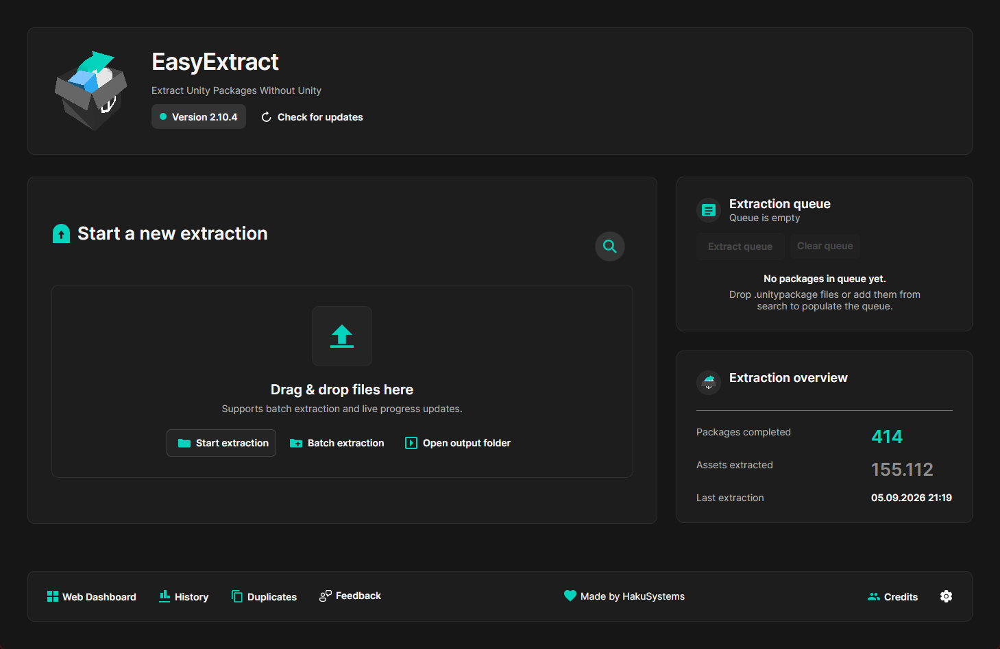
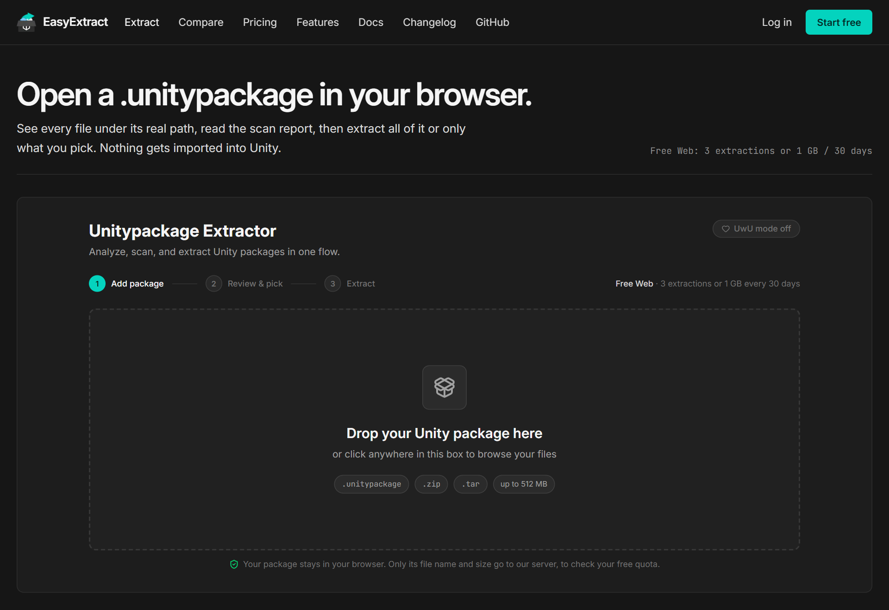

# EasyExtract.net

  
  
   
  
  
  
  

 

## What is EasyExtract?

EasyExtract is the ultimate tool to unpack, inspect, and manage Unity packages (`.unitypackage`) **without ever opening the Unity Editor**. The web app also opens `.zip` and `.tar` archives that contain a package.

Whether you are a developer checking assets or a power user managing a massive library, EasyExtract has you covered: a browser app for quick jobs and a cross-platform desktop app (built with **Avalonia**) for big local libraries.

**Choose your weapon:**
* **Web App:** The fastest way to start. Instant, no-install extraction directly in your browser.
* **Desktop Client:** Free offline extraction, auto-updates, system-wide search, a duplicate finder, and deep integration.
* **Discord Bot:** Scan a single package with `/analyze`, right inside the EasyExtract Discord server.

---

## Download & Quick Start

### Web Version
*The fastest way to get value.*

1.  Go to [easyextract.net](https://www.easyextract.net/extract).
2.  Drag & drop a `.unitypackage` (or a `.zip` / `.tar` that contains one).
3.  Preview, scan, pick the files you want, and extract them into a folder or as a ZIP.
4.  **Free Web** includes **3 extractions or 1 GB every 30 days**. Need more? Add **10 extractions for €2** (one-time) or go unlimited with **Premium Web for €15/month**. Current plans: [easyextract.net/premium](https://www.easyextract.net/premium).

### Desktop App (Windows, macOS, Linux)
*Free offline extraction with auto-updates.*

1.  **Download** the latest release from [GitHub Releases](https://github.com/HakuSystems/EasyExtractUnitypackage/releases).
2.  **Install & Run:**
    * **Windows (x64):** Download and run `EasyExtractCrossPlatform-win-Setup.exe`. It installs to your local app data and launches automatically. Prefer no installer? Use `EasyExtractCrossPlatform-win-Portable.zip`.
    * **Linux (x64):** Download `EasyExtractCrossPlatform.AppImage`, make it executable (`chmod +x`), and run it.
    * **macOS (Apple Silicon):** Install `EasyExtractCrossPlatform-osx-Setup.pkg`, or use `EasyExtractCrossPlatform-osx-Portable.zip`.
3.  **Enjoy:** Drag & drop packages, or let the search find them for you.

*(Check [Installation Docs](https://github.com/HakuSystems/EasyExtractUnitypackage/blob/main/EasyExtractUnitypackageRework/EasyExtractCrossPlatform/docs/PlatformInstallation.md) for detailed steps)*

---

## Desktop Features (Power User)

The Desktop app is built for speed and safety on **.NET 10** and **Avalonia**.

### Smart Extraction Workflow
* **Auto-Updates:** Integrated **Velopack** keeps the app up to date (can be switched off in Settings).
* **Batch & Queue:** Queue as many packages as you like via drag & drop, the file picker, search results, or the command line (`--extract <files>`).
* **Live Progress:** The dashboard shows the current package and asset, assets extracted, elapsed time, and what is next in the queue.
* **Selective Extraction:** Open a package in the preview, tick only the assets you need, and extract just those. Single assets can be exported directly.
* **Organized Output:** Default output and temp folders, optionally sorted into category folders.
* **Extraction Limits:** Per-asset, per-package, and asset-count caps (512 MB, 32 GB, and 25,000 by default, all adjustable) stop bloated or malicious packages before they fill your disk.
* **Offline First:** Extraction runs entirely on your machine. With a connection, the app checks for updates, adds a short record of each run (file name, size, status, duration) to your web dashboard, and reports crashes automatically.

### Discovery & Global Search
Stop digging through folders. EasyExtract finds your packages instantly.
* **Windows:** Integrated **Everything SDK** for instant, system-wide results (needs the free [Everything](https://www.voidtools.com/) app running).
* **macOS:** Native **Spotlight** integration.
* **Linux:** Uses `fd`, `plocate`, `locate`, or `find` to locate packages.
* **Queue Management:** Add search results to the queue or open their folder directly.

### Library Tools
* **Duplicate Finder:** Pick a folder and EasyExtract fingerprints every asset in its packages by content (SHA-256), so you see what you store more than once, even under different names.
* **History & Analytics:** A persistent history with daily activity, a throughput chart, and a timeline of recent runs.
* **Web Dashboard:** One click links the app to your easyextract.net dashboard, so the browser and the app share the same extraction history.

### Preview & Security (Anti-Malware)
Don't import blind. Know what's inside.
* **Rich Previews:** Browse the package as a searchable tree, then inspect images, PDFs, and text, play WAV, MP3, and AIFF audio, and view 3D models (OBJ, FBX, DAE, 3DS, STL, DXF, and prefabs that reference them) *before* extraction.
* **Malicious Code Detection:** Optional scan (turn on "malicious code warnings" in Settings) of `.cs`, `.js`, `.boo`, and `.dll.txt` assets up to 5 MB each. It flags Discord webhooks, links outside a list of known domains, and risky calls such as `Process.Start`, registry access, file deletion, sockets, reflection, and `DllImport`.
* **Safety Banners:** Visual warnings in the dashboard if a package contains threats.

### UX & Integrations
* **Customizable:** Light/Dark themes (or follow the system), custom background images (local/URL), and opacity controls.
* **Discord Rich Presence:** Shows what you are extracting, your queue, and your totals.
* **System Integration:** "Extract with EasyExtract" context menu entry in Windows Explorer, Linux file managers, and the macOS Services menu (on by default, toggle in Settings).
* **Notifications & Sounds:** Notifications for finished extractions, plus optional sound cues.
* **Feedback:** Send ideas and bug reports straight to the developer from inside the app.
* **UwU Mode:** Don't ask, just toggle it in settings.

---

## Web App Features

* **Zero Install:** Runs in your browser. The package is unpacked locally and never uploaded; only its file name and size go to the server to check your quota.
* **More Than .unitypackage:** Also opens a `.zip` or `.tar` that contains a package. Packages can be up to 512 MB (2 GB unpacked, 25,000 assets, 256 MB per asset); bigger ones are a job for the desktop app.
* **Review & Pick:** See every file under its real path, search the list, and extract all of it or only what you pick, into a folder or as a ZIP download.
* **Asset Preview Gallery:** Thumbnails of the package's assets. The first 12 are free; any paid plan unlocks the rest (up to 400 previews per package).
* **Live Speed & ETA** while a package extracts.
* **Package Diff:** Compare two versions of a package side by side and see added and removed files and new security findings ([easyextract.net/compare](https://www.easyextract.net/compare)).
* **Security:** Built-in scanner for webhooks, links, and risky APIs in scripts (`.cs`, `.js`, `.boo`, `.dll.txt`, up to 2 MB each) before you download.
* **Dashboard:** Extraction stats, quota, and history. Redeem a license key for Premium Web there.
* **Free First Use:** Start with 3 extractions or 1 GB every 30 days before you ever need to pay.
* **Paid Options:** 10 more extractions for €2 (one-time), or **Premium Web** for €15/month: unlimited browser extraction, the preview gallery, account access and history on every device, and priority support.

---

## Discord Bot

Join the [EasyExtract Discord server](https://discord.gg/Wn7XfhPCyD), run `/analyze`, and attach a `.unitypackage`. The bot replies with SAFE, UNSAFE, or SKIPPED, the threat level, and up to five findings. One package per command. Unlike the browser, the bot cannot scan on your device: it sends the file to the EasyExtract API, and both delete their copy once the scan is done ([Bot docs](https://www.easyextract.net/docs/discord-bot)).

---

## Feature Comparison

| Feature | Web Version | Desktop App |
| :--- | :---: | :---: |
| **Platform** | Browser | **Windows, Linux, macOS** |
| **Setup** | **Instant** | One-Click Installer (Auto-Update) |
| **Account History** | **Yes** | Local history, linkable to the web dashboard |
| **Free Limit** | **3 extractions or 1 GB / 30 days** | Completely free |
| **Paid Upgrade** | **10 more for €2, Premium Web €15/month** | None |
| **Size Limits** | 512 MB per package | Adjustable (32 GB per package by default) |
| **Previews** | Thumbnail gallery, first 12 free | **Images, PDFs, text, audio, 3D models** |
| **Malware Scan** | Webhooks, links, risky APIs | Webhooks, links, risky APIs (opt-in) |
| **Live Progress** | **Speed & ETA** | Package, asset, and elapsed time |
| **Batch Processing** | Good for quick jobs | **Best for large local queues** |
| **Duplicate Finder** | No | **Yes** |
| **Package Diff** | **Yes** | No |
| **System Search** | No | **Yes** |
| **Offline Access** | No | **Yes** |
| **Context Menu** | No | **Yes** |
| **Cost** | Free to start, paid for unlimited | **Free** |

---

## Gallery

### Extraction History

  

### Settings & Themes

  

### Web Interface

  

 

### Demos

https://github.com/user-attachments/assets/1d2048e6-e4e3-43e8-b83d-1b1d7f65bd76

https://github.com/user-attachments/assets/7492bc68-1279-4599-b041-3588657e4378

---

## License

EasyExtract is released under the [MIT License](LICENSE). Third-party components keep their own licenses,
listed in [THIRD-PARTY-NOTICES.md](THIRD-PARTY-NOTICES.md).

The license covers the code. It grants no rights to the EasyExtract name or logo, so a fork needs its own
name and logo.

---

## Connect & Support

* **Discord:** [Join the Community](https://discord.gg/Wn7XfhPCyD)
* **Issues:** [Report a Bug](https://github.com/HakuSystems/EasyExtractUnitypackage/issues)

Maintained by [HakuSystems](https://github.com/HakuSystems). **Star the repo if it saved you time!**
